# Week 10 — Adversarial Debiasing on UCI Adult

Answers to Q1–Q12 of `docs/instruction.md`. All numbers come from
`Debiasing/experiments.py` (20 epochs, seed 42, one run per configuration); the
matching run directory is named in each section and the full table is in
`Debiasing/runs/summary.csv`.

- Code: `Debiasing/` (`main.py` = the three core runs; `experiments.py` = all
  Q1–Q12 runs; see `docs/KAGGLE.md` to reproduce on Kaggle).
- Results: `Debiasing/runs/<tag>/results.json`, `history.csv`, `curves.png`;
  one table of everything in `Debiasing/runs/summary.csv`.
- Figures: `docs/figures/`.

## TL;DR

- Removing `sex` does not remove the bias: relationship, marital status,
  occupation and hours reconstruct it (Q5). Baseline DP gap: 0.182.
- Parity closes DP (0.014) but the TPR gap **flips and triples** (0.088 →
  0.287). With base rates 0.31 vs 0.11, equal selection rates force different
  error rates (Q3).
- DP and EO cannot both hold at unequal base rates — only a trivial classifier
  can satisfy both (Q4). Eq-odds cuts the TPR/FPR gaps to 0.080/0.027 but
  necessarily leaves DP at 0.117.
- More adversary capacity does not help: a hidden layer is slightly less stable
  (Q6), and feeding the adversary the 64-d representation fails to close DP
  (Q11).
- Gradient reversal halves DP (0.086) with little accuracy loss, but does not
  fix TPR (Q10). The `√t` schedule reaches the same endpoint as constant α
  (Q7).
- Race is about half as biased in absolute terms but equally biased relative to
  its base-rate gap (0.91× in both cases), and harder to debias to DP (Q8).
- Post-hoc group thresholds land on almost exactly the parity model's operating
  point (Q12): both are equally accurate, so the choice is deployability.

## Contents

[Q1](#q1) · [Q2](#q2) · [Q3](#q3) · [Q4](#q4) · [Q5](#q5) · [Q6](#q6) ·
[Q7](#q7) · [Q8](#q8) · [Q9](#q9) · [Q10](#q10) · [Q11](#q11) · [Q12](#q12) ·
[Limitations](#limitations)

## Setup

| Item | Value |
|---|---|
| Data | UCI Adult (OpenML v2), rows with missing values dropped → 45,222 |
| Split | 70 / 15 / 15 train/val/test, stratified on the 4 `(y, z)` cells |
| Features | 101 after one-hot; `fnlwgt` dropped; numeric columns standardized (fit on train) |
| Predictor | `101 → 64 → 64 → 1`, ReLU; Adam `1e-3`, cosine LR decay |
| Adversary | Adam `1e-2`; parity: 1 input; eq-odds: 4; eq-opp: 1 (loss on `y=1` only) |
| Update | Zhang et al. projection: `∇_P = ∇L_P − proj_{∇L_A}∇L_P − α∇L_A`, adversary stepped separately on detached output |
| α | 1.0 unless stated; `sqrt(t)` = `α·√(t/T)` (0.22 → 1.0) |

Base rates: `P(y=1|M)=0.313`, `P(y=1|F)=0.114` (gap 0.199); `P(z=Male)=0.675`.
Race scenario: White 86%, `P(y=1|White)=0.262`, `P(y=1|non-White)=0.158`
(gap 0.104).

### Core results (test set, threshold 0.5)

| Run | accuracy | DP gap | TPR gap | FPR gap | P(ŷ=1\|z=1) | P(ŷ=1\|z=0) |
|---|---|---|---|---|---|---|
| Baseline | 0.8530 | 0.1817 | 0.0877 | 0.0726 | 0.2697 | 0.0880 |
| Parity | 0.8339 | **0.0141** | 0.2874 | 0.0427 | 0.1769 | 0.1628 |
| Equalized odds | 0.8474 | 0.1169 | **0.0798** | 0.0272 | 0.2448 | 0.1279 |

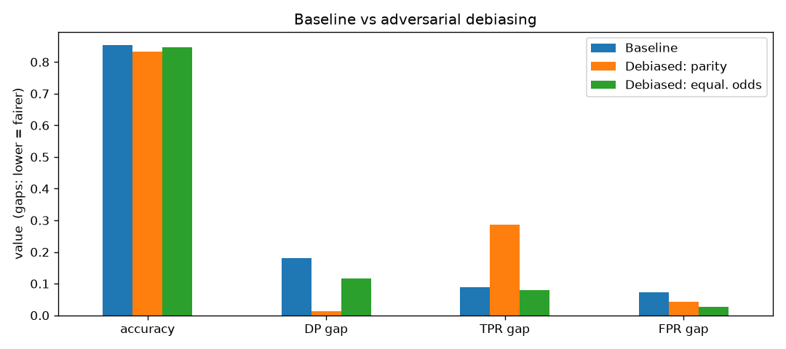

Test metrics across training (accuracy and gaps):

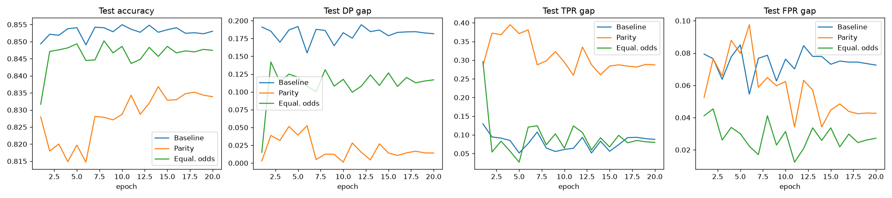

---

<a id="q1"></a>

## Q1 — How does `L_A` change in parity vs equalized-odds mode?

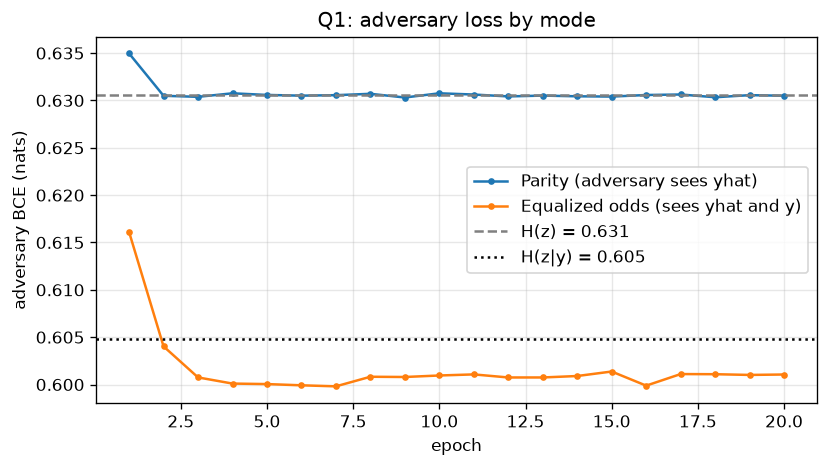

| Mode | first | last | min | last-10 std | reference floor |
|---|---|---|---|---|---|
| Parity | 0.6350 | 0.6305 | 0.6303 | 0.0001 | `H(z) = 0.6305` |
| Equalized odds | 0.6161 | 0.6011 | 0.5998 | 0.0004 | `H(z|y) = 0.6048` |

In **parity** mode the adversary's loss falls onto `H(z) ≈ 0.630` in the first
epoch and then stays flat. That is exactly the loss of a predictor that only
knows the base rate: `ŷ` carries no usable sex information, so the best the
adversary can do is guess "male" with probability 0.675. Flatness matters more
than the level — a still-decreasing `L_A` would mean the predictor is still
leaking.

In **equalized-odds** mode the floor is *lower*, `H(z|y) ≈ 0.605`, because the
adversary is allowed to see the true label: `P(z=1|y=1)=0.85` and
`P(z=1|y=0)=0.62`, so `y` alone already predicts sex. The lower loss therefore
does **not** mean the EO model leaks more. The correct comparison is to
`H(z|y)`, not to `H(z)` or `ln 2`. Both runs sit on their floors with tiny
epoch-to-epoch variance (0.0001 / 0.0004), i.e. the two-player game converged
rather than oscillating.

Caveats. (i) `L_A` is measured on training batches during the predictor update,
before the adversary's own step, so it is a slightly stale estimate. (ii)
`L_A ≈ H(z)` is a **log-loss** criterion and can hide moderate distribution
differences, especially for imbalanced groups. For race parity (86% White) the
best linear adversary on the score gains only 0.0025 nats over the base rate,
yet the selection rates still differ by 5.9 pp (see Q8). So "the adversary is at
chance" is necessary but not sufficient evidence of parity.

<a id="q2"></a>

## Q2 — Score histograms: how does debiasing change the two distributions?

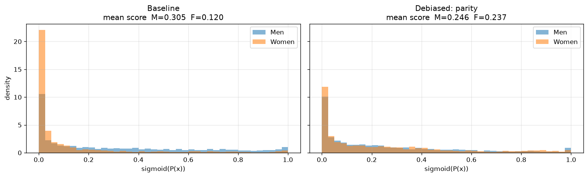

| Model | mean score M | mean score F | histogram overlap | KS distance |
|---|---|---|---|---|
| Baseline | 0.305 | 0.120 | 0.656 | 0.346 |
| Parity | 0.246 | 0.237 | 0.902 | 0.051 |

Debiasing moves the whole female score distribution **up** and the male
distribution **down/compressed**, so the two distributions overlap much more:
the overlap coefficient rises 0.66 → 0.90 and the maximum CDF gap (KS) falls
0.35 → 0.05. The mass at the decision threshold equalizes too: 27.0% of men vs
8.8% of women are predicted positive at baseline, 17.7% vs 16.3% after parity
training.

They are not identical, though. Parity constrains only the group selection
rates, not the full distribution, so the shapes still differ slightly (KS
0.05). Also, after adversarial training the scores are **ranking scores, not
calibrated probabilities** — the parity model's mean score (0.24) is well above
its selection rate (0.17), so don't read `sigmoid(P(x))` as `P(y=1|x)`.

<a id="q3"></a>

## Q3 — Parity nearly closes the DP gap, but what happens to the TPR gap?

| Run | sel M | sel F | TPR M | TPR F | TPR gap | FPR M | FPR F |
|---|---|---|---|---|---|---|---|
| Baseline | 0.270 | 0.088 | 0.642 | 0.554 | 0.088 (M>F) | 0.101 | 0.028 |
| Parity | 0.177 | 0.163 | 0.470 | **0.757** | **0.287 (F>M)** | 0.044 | 0.086 |
| Eq. odds | 0.245 | 0.128 | 0.597 | 0.677 | 0.080 (F>M) | 0.084 | 0.057 |

The TPR gap does not shrink — it **flips sign and more than triples**. The
reason is the base-rate difference. Demographic parity fixes one number, the
total positive rate `π`, and leaves the group-specific error rates free:

```
π = TPR_z · b_z + FPR_z · (1 − b_z),      b_M = 0.313,  b_F = 0.114.
```

For women, only 11.4% of examples are positive, so a given selection rate is a
much larger fraction of their positives. With the observed `sel_F = 0.163` and
`FPR_F = 0.086`, `TPR_F = (0.163 − 0.086·0.886)/0.114 ≈ 0.76`; for men the same
budget spreads over three times as many positives, and `sel_M = 0.177`,
`FPR_M = 0.044` give `TPR_M ≈ 0.47`. The group with
fewer positives must catch a much larger share of them (and admit more
negatives) to reach the same selection rate. Parity equalizes the **marginal**,
not the **conditional**; with unequal base rates the conditional gap is pushed
elsewhere, not removed.

<a id="q4"></a>

## Q4 — Can a non-trivial classifier satisfy DP *and* EO when base rates differ?

No. DP gives equal selection rates `π_M = π_F = π`; EO gives equal TPR and FPR,
`t` and `f`. Substituting into the identity above:

```
π = t·b_M + f·(1−b_M) = t·b_F + f·(1−b_F)
⇒ (t − f)(b_M − b_F) = 0.
```

Since `b_M ≠ b_F`, either `t = f` or the classifier is constant — both mean the
classifier ignores the features (a coin flip/constant), i.e. it is trivial.
Perfect prediction (`t=1, f=0`) also fails DP unless the base rates are equal.
So with `b_M=0.313` vs `b_F=0.114`, **no non-trivial classifier** can satisfy
DP and EO at once; one must trade them off.

Our runs show the two ends of that trade-off and the implied arithmetic:

- Parity: DP 0.014, TPR 0.287.
- Eq-odds: TPR 0.080 / FPR 0.027, DP 0.117 — and EO *implies* a DP gap of
  roughly `(t−f)·|b_M−b_F| ≈ (0.60−0.06)·0.199 ≈ 0.107`, close to the
  observed 0.117.

<a id="q5"></a>

## Q5 — Why is the baseline still biased after removing `sex`?

The model reconstructs sex from proxy features. Point-biserial correlation with
`z` (Male=1) on the training set, top 12:

| Feature | r with sex |
|---|---|
| `relationship=Husband` | +0.583 |
| `marital-status=Married-civ-spouse` | +0.438 |
| `relationship=Unmarried` | −0.321 |
| `relationship=Wife` | −0.318 |
| `occupation=Adm-clerical` | −0.284 |
| `marital-status=Divorced` | −0.233 |
| `hours-per-week` | +0.232 |
| `occupation=Craft-repair` | +0.230 |
| `marital-status=Widowed` | −0.181 |
| `marital-status=Never-married` | −0.181 |
| `relationship=Not-in-family` | −0.178 |
| `occupation=Other-service` | −0.164 |

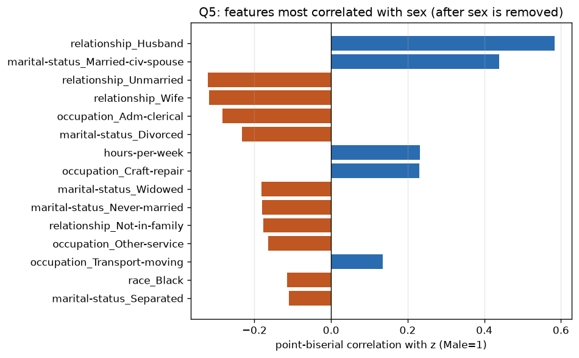

`Husband`/`Wife` and marital status are close to explicit sex indicators;
occupation is strongly segregated (women over-represented in clerical/service
jobs, men in craft/repair); men work more hours on average. Together these
features carry enough of the sex signal that the model can reconstruct much of
the bias that `sex` itself would have provided, and they are also predictive of
income, so the model uses them. Removing the protected column
removes the *explicit* signal only — the bias travels through correlated
features. This is also why input-level fixes are not enough and the paper
attacks the output instead.

<a id="q6"></a>

## Q6 — Give the adversary a hidden layer: more effective, or less stable?

| Run | accuracy | DP gap | TPR gap | FPR gap | last-10 DP (mean±std) | last-10 `L_A` |
|---|---|---|---|---|---|---|
| Parity, 1 layer | 0.8339 | 0.0141 | 0.2874 | 0.0427 | 0.016 ± 0.007 | 0.630 ± 0.000 |
| Parity, hidden 64 | 0.8367 | 0.0188 | 0.2745 | 0.0405 | 0.021 ± **0.013** | 0.631 ± 0.000 |
| Eq-odds, 1 layer | 0.8474 | 0.1169 | 0.0798 | 0.0272 | 0.114 ± 0.008 | 0.601 ± 0.000 |
| Eq-odds, hidden 64 | 0.8510 | 0.1365 | **0.0402** | 0.0429 | 0.136 ± **0.010** | 0.601 ± 0.000 |

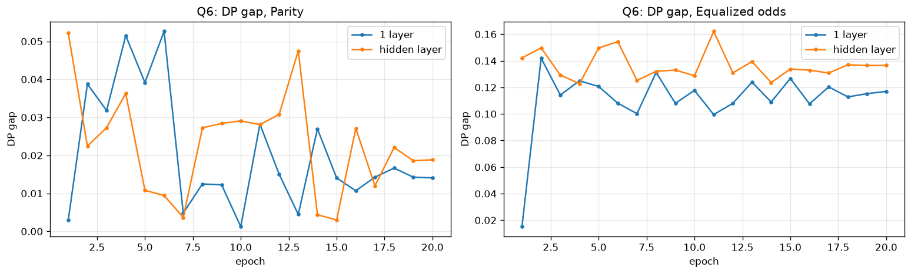

**Less stable, not clearly more effective.** In parity mode the hidden
adversary gives a slightly worse DP gap (0.019 vs 0.014) and roughly **twice**
the epoch-to-epoch DP variance, with no accuracy gain worth the trade. In
eq-odds mode it does push harder on TPR (gap 0.080 → 0.040) but at the cost of
a larger FPR gap (0.027 → 0.043) and DP gap (0.117 → 0.137).

A richer adversary fits the remaining group signal faster and can win the
min-max game outright, so the predictor is dragged around rather than nudged;
with a fixed α the extra capacity mainly buys variance. The paper's single
linear adversary is a deliberate stabilizer, not a limitation.

<a id="q7"></a>

## Q7 — Grow the adversary weight like `√t`

**Question:** implement `α_t ∝ √t` and compare the result with the baseline.
Implementation: `α_t = α·√(t/T)` over the 20 epochs (0.22 → 1.0). I did **not**
use a raw `α·√t`, which would reach 4.5× by epoch 20 and risk divergence.

| Run | accuracy | DP gap | TPR gap | FPR gap |
|---|---|---|---|---|
| Baseline | 0.8530 | 0.1817 | 0.0877 | 0.0726 |
| Parity, constant α | 0.8339 | 0.0141 | 0.2874 | 0.0427 |
| Parity, `√t` | 0.8349 | **0.0094** | 0.2881 | 0.0485 |

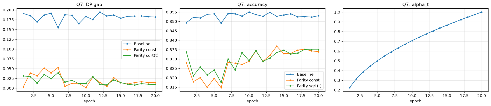

Against the baseline, the ramp removes ~95% of the DP gap for 1.8 pp of
accuracy — the same bargain as constant α. The final numbers are within
0.1–0.5 pp of constant α; the difference is in the **trajectory**: at epoch 1
`α=0.22` and DP is 0.031, and the gap shrinks as α grows (0.024 at epoch 5,
0.012 at 10, 0.014 at 15, 0.009 at 20), whereas constant α is already at DP
0.003 after one epoch and then fluctuates in the 0.001–0.014 range.

So the `√t` schedule acts as a warm-up: early epochs are spent fitting the
label, the adversary takes over later. Here it neither helps nor hurts the
final accuracy meaningfully, because the model is small and 20 epochs with
cosine LR is enough for both. It should matter more with a larger model or a
longer schedule, where a strong α from step 1 can collapse accuracy; the
paper's motivation is exactly that. Caveat: the scaling is a choice — a raw
`√t` is not comparable to a constant α of 1.

<a id="q8"></a>

## Q8 — Race instead of sex: is the baseline more or less biased?

`z = 1` for White, 0 otherwise; `race` removed from the features, `sex` kept.
The three models are the same code path as `main.py`, run with
`load_adult(protected="race")` (`race_baseline`, `race_parity`,
`race_eq_odds`).

| Scenario | base rates | base-rate gap | accuracy | DP gap | TPR gap | FPR gap |
|---|---|---|---|---|---|---|
| Sex: baseline | 0.313 / 0.114 | 0.199 | 0.8530 | 0.1817 | 0.0877 | 0.0726 |
| Race: baseline | 0.262 / 0.158 | 0.104 | 0.8545 | **0.0946** | 0.0619 | 0.0305 |
| Race: parity | — | — | 0.8533 | 0.0592 | 0.0175 | 0.0056 |
| Race: eq-odds | — | — | 0.8558 | 0.0841 | 0.0100 | 0.0282 |

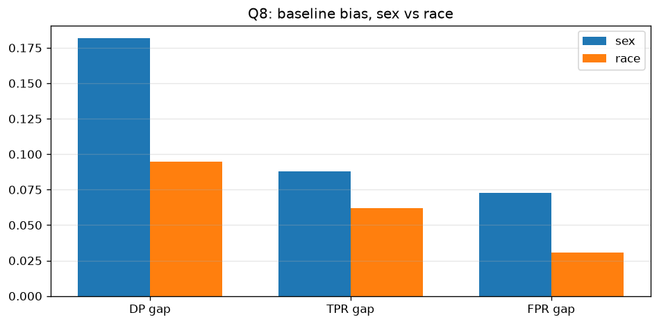

**Less biased in absolute terms, about equally biased relative to the base
rates.** The race DP gap (0.095) is roughly half the sex DP gap (0.182), but
the race base-rate gap is also roughly half (0.104 vs 0.199). The ratio
`DP gap / base-rate gap` is 0.91 in both cases — the baseline's selection gap
is largely the base-rate gap passed through a ~0.6 TPR, so the "fairness" of
the baseline tracks how different the groups' incomes are, not how the model
treats them. In annual-income terms, the 1994 census has a much larger male–
female income gap than White–non-White gap.

Two race-specific caveats. (i) Non-White is only 14% of the data (~18 examples
per batch), so the adversary's gradient is noisy and the estimates are less
stable. (ii) Race parity only reduced DP to 0.059 (vs 0.014 for sex), and its
per-group rates show why. TPR (0.622 / 0.640) and FPR (0.072 / 0.066) are nearly
equal, while selection rates are 0.216 / 0.157. That is an **equalized-odds-like
endpoint, not a DP one**: with base rates 0.262 vs 0.158, nearly equal
conditional rates still produce a selection gap of
`(TPR − FPR)·(b_W − b_N) ≈ 0.56·0.104 ≈ 0.058`. The linear adversary saturates
at `H(z)=0.404` because log-loss is dominated by the 86% majority — the best
linear adversary on the score gains only 0.0025 nats while the selection gap is
5.9 pp. So under imbalance, "adversary at chance" is a weak parity certificate,
and this run effectively converged to EO. Race is less biased in absolute
terms, but harder to debias to *DP* with the same setup.

<a id="q9"></a>

## Q9 — `eq_opp`: adversary loss on `y=1` only

| Run | accuracy | DP gap | TPR gap | FPR gap |
|---|---|---|---|---|
| Eq-odds | 0.8474 | 0.1169 | 0.0798 | 0.0272 |
| Eq-opp | 0.8547 | 0.1635 | **0.0292** | 0.0609 |

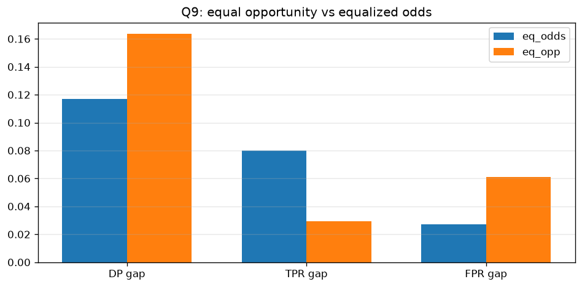

Eq-opp does exactly what it is asked: the TPR gap falls from 8.0 pp to **2.9
pp**, the best of the three core modes (parity 28.7, eq-odds 8.0, eq-opp 2.9).
But it pays for that on the
other side of the confusion matrix: FPR gap more than doubles (2.7 → 6.1 pp)
and the DP gap grows (11.7 → 16.4 pp), with accuracy *higher* than eq-odds
(the constraint is weaker). The adversary sees only `y=1` examples, so nothing
constrains the negatives. Here it equalizes TPR by **lowering** the previously
higher female TPR (0.677 → 0.598) and raising the male TPR (0.597 → 0.627); the
male FPR rises (0.084 → 0.092) while the female FPR falls (0.057 → 0.031),
which is why the FPR and DP gaps widen. The constraint is satisfied, but by
moving the two groups' decision rates apart. `L_A` settles at 0.420 ≈
`H(z|y=1)=0.421`, i.e. chance *among positives*, which is the right floor for
this objective.

Equal opportunity is the right constraint when the harm is a *missed positive*
(a qualified applicant rejected); it is too weak when false positives are also
costly, which is why eq-odds is the stricter default. Masking also throws away
~75% of each batch, so the adversary gets a noisier gradient.

<a id="q10"></a>

## Q10 — Gradient reversal, one `loss.backward()`

`GradReverse` is identity forward and multiplies the incoming gradient by
`−α` backward; it sits between predictor and adversary, and
`L = L_P + L_A` is differentiated once.

| Run | accuracy | DP gap | TPR gap | FPR gap |
|---|---|---|---|---|
| Baseline | 0.8530 | 0.1817 | 0.0877 | 0.0726 |
| Parity (projection) | 0.8339 | 0.0141 | 0.2874 | 0.0427 |
| GRL | 0.8473 | 0.0864 | 0.1557 | 0.0084 |

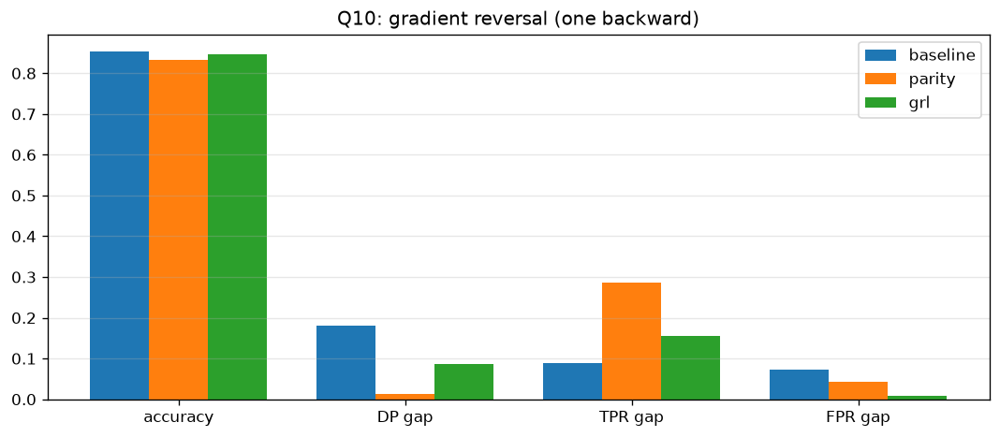

GRL cuts the DP gap by ~52% and the FPR gap by ~88% for only 0.6 pp of
accuracy — but it does **not** equalize TPR (gap rises from 8.8 to 15.6 pp, and
flips direction: women 0.709 vs men 0.553). It is a middle ground: the same
min-max idea as the projection, much simpler to
implement (one backward, no separate adversary step, no manual gradient
surgery), but α is the only control and the two networks update simultaneously,
so the equilibrium is coarser. The projection method is more effective at
removing the group signal (DP 0.014 vs 0.086); GRL is cheaper and easier to
bolt onto an existing model, and its result is sensitive to α and to the
predictor/adversary learning-rate ratio.

<a id="q11"></a>

## Q11 — Give the adversary the predictor's 64-d hidden layer

| Run | accuracy | DP gap | TPR gap | FPR gap | last-10 DP | last-10 `L_A` |
|---|---|---|---|---|---|---|
| Adversary on `ŷ` | 0.8339 | **0.0141** | 0.2874 | 0.0427 | 0.016 ± 0.007 | 0.630 ± 0.000 |
| Adversary on `h` (64-d) | 0.8511 | 0.1457 | 0.0194 | 0.0502 | 0.135 ± **0.016** | 0.626 ± **0.018** |

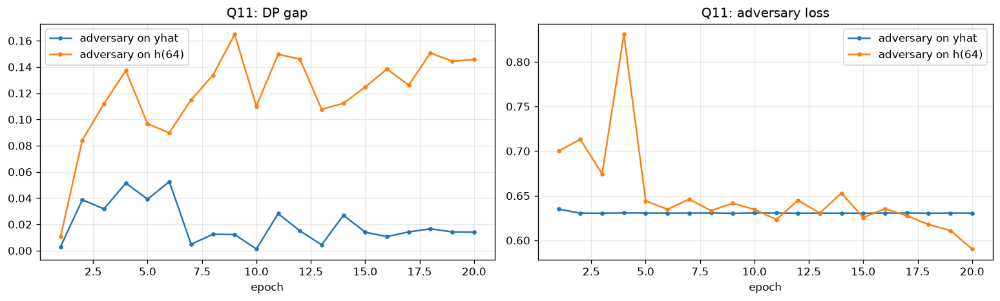

**No — the parity gap does not close, and training is less stable.** The DP gap
ends at 0.146, close to the baseline's 0.182 and ten times the output-adversary
result (0.014). The TPR gap is small (0.019), so this variant behaves like an
**equalized-odds** solution rather than a parity one: selection rates stay far
apart (0.252 vs 0.107) while TPR is nearly equal (0.610 vs 0.629). `L_A` falls
from 0.700 to 0.590, i.e. *below* `H(z)=0.630`, so
the adversary really is decoding sex from the 64-d layer; the representation
still leaks, and the epoch-to-epoch variance is more than twice as large.

Why does more adversary information make things worse? The projection update
cancels only the component of the predictor gradient that lies along the
current (single) adversary-gradient direction. With a scalar output that one
direction is essentially the whole channel. With a 64-d representation the
group information is spread across many parameter directions; removing one
leaves the others, and the adversary — now much better informed — keeps finding
them. Accuracy is *higher* than the parity model precisely because less
debiasing pressure got through. The practical lesson: under this update rule,
feeding the adversary a rich representation is not a free upgrade; it needs a
stronger mechanism (or a constrained adversary) to work.

<a id="q12"></a>

## Q12 — Separate thresholds for men and women on the baseline

Thresholds chosen on the **validation** split (never test): target positive
rate 0.148, `thr_M = 0.708`, `thr_F = 0.276`, validation DP gap 0.0001,
validation accuracy 0.8367.

| Run | accuracy | DP gap | TPR gap | FPR gap | sel z=1 | sel z=0 |
|---|---|---|---|---|---|---|
| Baseline @ 0.5 | 0.8530 | 0.1817 | 0.0877 | 0.0726 | 0.2697 | 0.0880 |
| Baseline + group thresholds | 0.8343 | 0.0129 | 0.2976 | 0.0351 | 0.1540 | 0.1410 |
| Adversarial parity | 0.8339 | 0.0141 | 0.2874 | 0.0427 | 0.1769 | 0.1628 |

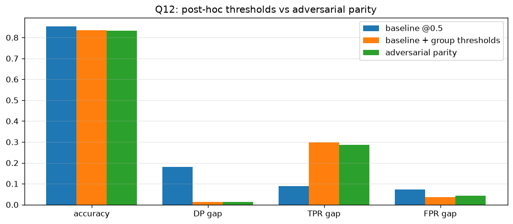

The two approaches land on almost the **same operating point**: accuracy
differs by 0.04 pp, DP by 0.12 pp, TPR gap by 1 pp (parity slightly better),
FPR gap by 0.8 pp (thresholds slightly better). Both cost ~1.9 pp of accuracy
relative to the untuned baseline.

- **Simpler:** the thresholds. No retraining, model-agnostic, one scalar per
  group, easy to audit and to apply to an already-deployed model. It changes
  only the decision rule, so nothing about the model or its training pipeline
  has to change.
- **Better:** depends on the deployment. If group membership is observable and
  only a yes/no decision is needed, thresholding is the pragmatic choice and
  just as accurate here. The adversarial model is better when `z` is not
  available at prediction time, when the *score/ranking* itself is used (not
  just a threshold), or when the operating point may shift — it changes the
  representation, not just one cut point.

Limits of thresholding: it fixes DP only at the chosen rate, is brittle under
distribution shift, requires the protected attribute at decision time, and
leaves the ranking biased (TPR gap 0.298). The adversarial model's advantage is
conceptual, not numerical, in this run.

<a id="limitations"></a>

## Limitations

- **One seed per configuration.** Differences below ~1 pp (e.g. Q7's 0.1 pp,
  Q12's 0.04 pp) are within run-to-run noise; do not over-read them.
- **20 epochs, fixed α = 1, one architecture.** The min-max game is not fully
  converged everywhere (eq-odds keeps an 8 pp TPR gap), so the numbers show the
  method's behavior at a workshop budget, not its best achievable fairness.
- `L_A` is logged on training batches at the predictor step; the reference
  floors `H(z)`, `H(z|y)`, `H(z|y=1)` are computed on the training split.
- Adult is a 1994 census snapshot; the base rates are historical.
- The race scenario collapses "White" vs everyone else, lumping very different
  groups together, and the non-White group is only 14% of the data.
- The test set is used only for reporting; Q12 tunes on validation.
